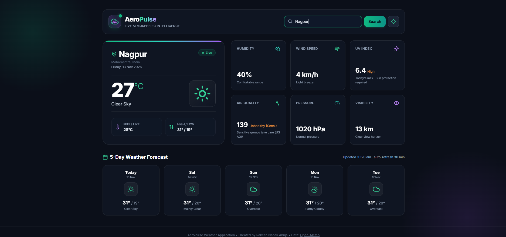

# AeroPulse - Live Atmospheric Intelligence

AeroPulse is a modern, real-time weather web app built with plain HTML, Tailwind CSS and JavaScript. Search any city in the world, or use your current location, to see live weather, air quality and a 5-day forecast in a clean dark glassmorphism interface.

**Created by Rakesh Nanak Ahuja**



---

## Features

- **Real-time weather:** current temperature, feels-like, humidity, wind speed, pressure and visibility.
- **UV Index and Air Quality:** today's maximum UV index and the current US AQI, each with a colour-coded label and a short health note.
- **5-day forecast:** daily high/low temperature and weather condition with icons.
- **City search:** find any city worldwide (multi-word names like "New York" work).
- **Use my location:** detects your coordinates with the browser Geolocation API and shows weather for where you are.
- **Day/night aware icons:** shows a moon icon at night and a sun icon during the day.
- **Auto-refresh:** data refreshes every 30 minutes, and the last updated time is shown.
- **Remembers your last city:** saved in the browser (`localStorage`).
- **Friendly error handling:** inline messages for city not found, location permission denied or network failure.
- **Responsive and accessible:** works on mobile and desktop, with labelled inputs and ARIA attributes.

## Tech Stack

| Purpose | Tool |
| --- | --- |
| Structure and logic | HTML5, Vanilla JavaScript |
| Styling | [Tailwind CSS](https://tailwindcss.com) (CDN, v3.4.17) |
| Icons | [Lucide](https://lucide.dev) (CDN, v0.469.0) |
| Font | [Inter](https://fonts.google.com/specimen/Inter) (Google Fonts) |

## Data Sources (no API key needed)

- [Open-Meteo Forecast API](https://open-meteo.com/en/docs): weather, UV and forecast
- [Open-Meteo Air Quality API](https://open-meteo.com/en/docs/air-quality-api): US AQI
- [Open-Meteo Geocoding API](https://open-meteo.com/en/docs/geocoding-api): city name to coordinates
- [BigDataCloud Reverse Geocoding](https://www.bigdatacloud.com/free-api/free-reverse-geocode-to-city-api): coordinates to city name (for "Use my location")

## Getting Started

No installation or build step is required.

1. Download or clone this project.
2. Open `index.html` in any modern browser (Chrome, Edge, Firefox, Safari).
3. An internet connection is required for weather data and the CDN assets.

> **Tip:** For the "Use my location" button to work reliably, run the app from a local server (for example the **Live Server** extension in VS Code, or `python -m http.server`) instead of opening the file directly. Browsers may block geolocation on `file://` pages.

## Project Structure

```
.
├── index.html   # Complete app (markup, styles and JavaScript)
└── README.md    # Project documentation
```

## How It Works

1. On load, the app shows the last searched city (default: **Nagpur**).
2. Searching a city calls the Geocoding API to get its coordinates.
3. The Forecast and Air Quality APIs are called in parallel with those coordinates.
4. The response is rendered into the dashboard, and icons are refreshed.
5. If a newer request starts before an older one finishes, the older response is ignored, so results never show for the wrong city.

## Good to Know

- **Temperature accuracy:** values come from a weather model and may differ by 1-2 °C from other apps.
- **AQI scale:** the app uses the **US AQI** scale, which differs from India's official CPCB AQI, so numbers may not match local apps.
- **UV Index:** shows today's **maximum** UV, not the value at this exact moment.
- **Free API usage:** Open-Meteo's free tier is intended for non-commercial use. For commercial use, check their terms or use a paid plan.
- **Tailwind CDN:** the Tailwind CDN build is meant for development and prototypes. For production, compile Tailwind with its build tool.

## Ideas for the Future

- °C / °F unit toggle
- Hourly forecast
- Sunrise and sunset times
- Light mode
- Saved favourite cities
- User accounts to sync favourite cities across devices
- Installable PWA with offline support

## Credits

- Weather data by [Open-Meteo](https://open-meteo.com) (licensed CC BY 4.0)
- Icons by [Lucide](https://lucide.dev)
- Reverse geocoding by [BigDataCloud](https://www.bigdatacloud.com)

## License

This project is licensed under the MIT License. See the [LICENSE](LICENSE) file for details.

## Author

**Rakesh Nanak Ahuja**

---

*AeroPulse: the heartbeat of the atmosphere.*
